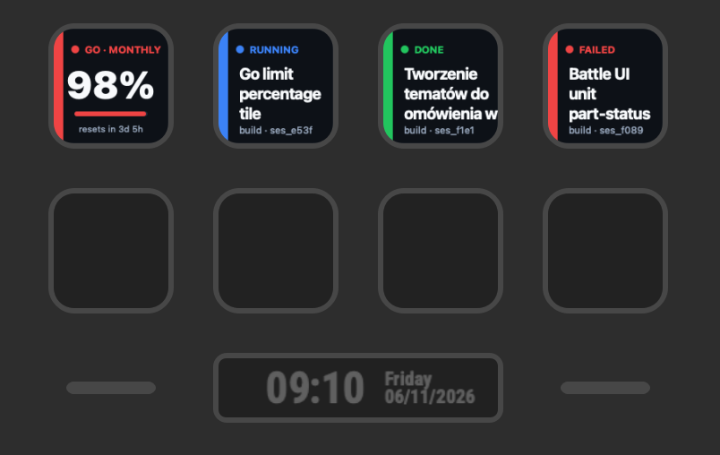

# OpenCode Sessions for Stream Deck

[](https://github.com/McCzarny/opencode-sessions/actions/workflows/build.yml)

A Stream Deck plugin that shows your current [OpenCode](https://opencode.ai) agent sessions, their
status, and your OpenCode Go usage. Put one key per session on your deck and watch them run.

```
┌───────────────┐  ┌───────────────┐  ┌───────────────┐  ┌───────────────┐
│ ● RUNNING     │  │ ● NEEDS INPUT │  │ ● UNREAD      │  │ ● GO · MONTH  │
│ Stream Deck   │  │ Refactor auth │  │ Battle UI     │  │          94%  │
│ extension…    │  │ middleware    │  │ icons         │  │ resets in 2d  │
│ build · a1b2  │  │ build · c3d4  │  │ explore · e5f │  │ ██████████░   │
└───────────────┘  └───────────────┘  └───────────────┘  └───────────────┘
```



## What it does

- **Session keys** — each key renders one OpenCode session: a status colour, the session title
  and a short subtitle (agent, pending prompts, id).
- **Go usage key** — shows the percentage of your OpenCode Go limit used, with a progress bar and
  the time until the window resets. Choose the rolling 5-hour, weekly, or monthly window.
- **Lots of keys, no setup** — by default keys claim their slot from their place on the deck, so a
  row of Session keys lines up with the first, second, third … session automatically.
- **Live status** — the plugin polls the local OpenCode service (active session drains, pending
  permission requests, and pending questions) to keep the status current.
- **Press to refresh** — pressing a key forces an immediate status or usage refresh.

### Status values

| Status         | Meaning                                                       |
| -------------- | ------------------------------------------------------------- |
| `RUNNING`      | The session is actively running in OpenCode.                  |
| `NEEDS INPUT`  | The session is waiting on a permission request or a question. |
| `UNREAD`       | The session finished and its latest idle transition is unseen. |
| `FAILED`       | The last turn failed.                                         |
| `STOPPED`      | The last turn was interrupted.                                |
| `DONE`         | The last turn succeeded and has been viewed.                  |
| `IDLE`         | No outcome recorded yet.                                      |
| `OFFLINE`      | The plugin cannot reach the OpenCode service.                 |
| `NO SESSION`   | The key has no session to show (slot empty or none pinned).   |

## Requirements

- Stream Deck 7.1 or newer.
- OpenCode V2 installed (the plugin discovers, or starts, the shared background service).
- OpenCode 2.2.5 or newer for the Go usage key.
- Node.js 20+ for building from source.

## Install from source

```sh
npm install
npm run build          # generates icons and bundles the plugin
```

Then link the `ai.opencode.streamdeck.sdPlugin` folder into Stream Deck. The easiest way is the
Stream Deck CLI (installed as a dev dependency):

```sh
npx streamdeck link ai.opencode.streamdeck.sdPlugin
```

Or install it manually by copying `ai.opencode.streamdeck.sdPlugin` into:

- macOS: `~/Library/Application Support/com.elgato.StreamDeck/Plugins/`
- Windows: `%appdata%\Elgato\StreamDeck\Plugins\`

During development:

```sh
npm run watch          # rebuild on change and restart the plugin
```

## CI and releases

- `.github/workflows/build.yml` runs on every push and pull request: typecheck, build, validate the
  manifest, package the plugin with `streamdeck pack`, and upload the `.streamDeckPlugin` as a build
  artifact.
- `.github/workflows/release.yml` runs when you push a `vX.Y.Z` tag: it builds the plugin and
  publishes the `.streamDeckPlugin` to a GitHub Release.
- `.github/dependabot.yml` keeps the GitHub Actions and npm dependencies up to date.

## Using it

1. Add a **Session** key to your deck (drag it from the **OpenCode Sessions** category).
2. Add a **Go usage** key to show the percentage of your OpenCode Go allowance used. In its
   property inspector choose the **rolling 5-hour**, **weekly**, or **monthly** window (monthly by
   default). Press the key to refresh.
3. In the Session property inspector choose how the key picks a session:
   - **Live slot** — the key follows a session in the list. By default **Slot source** is
     **By key position**: drop several Session keys and they line up with the first, second,
     third … session based on their place on the deck (row, then column). Pinned keys are skipped
     when numbering, so you can mix a few pinned keys with a position-ordered row. Switch **Slot
     source** to **Manual number** to type a session number instead (1 is the first session).
     **Scope** decides which sessions are counted: **All sessions** (the default) or **Running /
     waiting only**.
   - **Pinned session** — the key always shows one session you pick from the dropdown.
4. Press a key to refresh its status or usage immediately.

## How it works

- `src/plugin.ts` wires the actions to a shared `OpenCodeConnection`.
- `src/opencode/connection.ts` discovers or starts the local OpenCode service using the official
  [`@opencode/client`](https://www.npmjs.com/package/@opencode/client) service API, then polls
  `/api/session`, `/api/session/active`, `/api/permission/request`, and the per-session form and
  permission endpoints every few seconds. It also polls `/api/experimental/usage/limits` every
  minute while a Go usage key is visible.
- `src/render.ts` draws each key as an SVG data URL.
- `src/actions/session.ts` and `src/actions/usage.ts` are the Stream Deck actions, and
  `ai.opencode.streamdeck.sdPlugin/ui/*` contains their property inspectors.

## Limitations

- Stream Deck cannot add or remove keys at runtime, so the "view" is a set of keys you lay out
  (they are assigned by position or pinning).
- Session status updates are polled (default 2s) and Go usage every minute rather than pushed;
  press a key to refresh on demand.
- The Go usage key needs OpenCode 2.2.5 or newer (the service must expose the usage-limits
  endpoint) and an active OpenCode Go plan.
- The plugin only reads OpenCode state. It does not open or navigate OpenCode, because the desktop
  app has no session deep link yet.

## License

MIT
